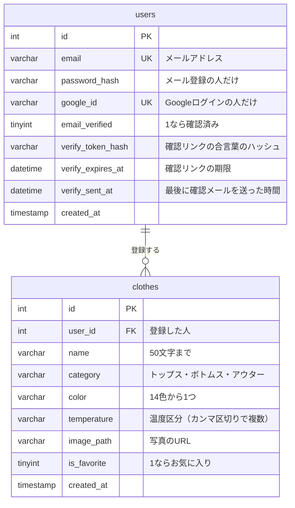

# WearCast

今日の天気と気温に合わせて、手持ちの服からコーディネートを提案するWebアプリです。
自分の服を写真付きで登録しておくと、都市名を検索したときにその気温に合った服を「アウター＋トップス＋ボトムス」で表示します。
アカウントごとに自分の服だけを管理できます。

## デモ動画


## 作った理由

毎朝、その日の気温に合う服を考えるのに時間がかかっていたため、
手持ちの服から気温に合ったコーディネートを自動で提案するアプリを作りました。

## 主な機能

### 🌤️ 天気とコーディネート

- **天気検索**：都市名を入れると、今の気温と天気を表示します。背景も天気に合わせて変わります。
- **おすすめコーディネート**：気温に合う服を、トップス・ボトムスから1着ずつランダムに出します。20°C以下のときはアウターも出します。
- **選びなおす**：気に入らなければボタンで、今出ている服をなるべく避けて別の組み合わせを出します。

### 👕 服の管理

- **登録**：名前、カテゴリー、色、温度区分、写真を登録します。
- **一覧**：登録した服を新しい順に、ページを分けて表示します。
- **絞り込み**：名前・カテゴリー・お気に入り・色・温度で絞り込めます。
- **お気に入り**：自分のお気に入りの服を星マークで登録できます。
- **詳細・編集・削除**：洋服の詳細を編集したり、使わなくなった洋服を削除できます。

### 🔐 ログインと安全対策

- **ログイン**：メールアドレスとパスワード、またはGoogleアカウントでログインします。ログインは30日間続きます。
- **メールアドレスの確認**：新規登録すると確認メールが届き、リンクを開くと登録が終わります。確認メールは送り直せます。
- **回数制限**：ログイン・新規登録・確認メールの再送に回数の上限をつけて、パスワードの総当たりや確認メールの大量送信を防いでいます。
- **そのほか**：サーバー側での入力チェック、XSS対策、アップロードの制限（10MBまでの画像だけ）もしています。

## 使用技術

| 区分 | 技術 |
| --- | --- |
| フロントエンド | HTML / JavaScript / Tailwind CSS（CDN） |
| バックエンド | Node.js / Express 5 |
| データベース | MySQL（ローカル：XAMPPのMariaDB、本番：TiDB Cloud） |
| 画像保存 | multer（ローカル：`public/uploads/`、本番：Cloudinary） |
| 認証 | cookie-session（署名付きCookie）、パスワードはNode.js標準の `crypto.scrypt` でハッシュ化、Google OAuth 2.0 |
| ホスティング | Render |
| 外部API | [Photon](https://photon.komoot.io/)（都市名 → 緯度経度、予備に[Nominatim](https://nominatim.org/)）、[MET Norway](https://api.met.no/)（天気） ※どれもAPIキー不要 |

## セットアップ（ローカル）

### 1. 必要なもの

- Node.js v20以上
- MySQL または MariaDB（XAMPPなど）

### 2. パッケージのインストール

```bash
npm install
```

### 3. データベースの作成

`db/schema.sql` を実行すると、データベース `wear_cast_db` と `clothes`・`users` テーブルが作られます。

接続設定は `src/config/db.js` にあります。環境変数が無ければ `localhost:3306` / ユーザー `root` / パスワードなし で接続します。

### 4. 環境変数（任意）

ローカルでは何も設定しなくても動きます。設定する場合は `.env.example` をコピーして `.env` を作ります。

| 変数 | 内容 |
| --- | --- |
| `DB_HOST` / `DB_PORT` / `DB_USER` / `DB_PASSWORD` / `DB_NAME` | DB接続情報 |
| `DB_SSL` | `true` でSSL接続（TiDB Cloudでは必須） |
| `CLOUDINARY_URL` | 設定すると画像をCloudinaryに保存（無ければ `public/uploads/`） |
| `BASE_URL` | アプリのURL（GoogleログインのリダイレクトURIに使用。省略時は `http://localhost:3000`） |
| `SESSION_SECRET` | Cookieの署名に使うランダムな文字列（本番では必須） |
| `GOOGLE_CLIENT_ID` / `GOOGLE_CLIENT_SECRET` | Googleログイン用（無ければGoogleログインだけ使えない） |
| `MAIL_FROM` / `MAIL_FROM_NAME` / `GMAIL_REFRESH_TOKEN` | 確認メールの送信（Gmail API）。無ければメールを送らず、確認リンクをターミナルに表示する |
| `GMAIL_CLIENT_ID` / `GMAIL_CLIENT_SECRET` | Gmail API用のOAuthクライアント（省略時は `GOOGLE_CLIENT_ID` / `GOOGLE_CLIENT_SECRET` を使用） |

`SESSION_SECRET` は次のコマンドで作れます。

```bash
node -e "console.log(require('crypto').randomBytes(32).toString('hex'))"
```

### 5. サーバーの起動

```bash
npm start
```

起動したら http://localhost:3000 を開きます。ログインしていない場合はようこそ画面（`welcome.html`）に移動します。

## 本番環境（Render）

- DBは TiDB Cloud を使用。`db/schema.sql` を TiDB Cloud の SQL Editor で実行してテーブルを作成
- Renderの無料プランは再起動でサーバー内のファイルが消えるため、画像は Cloudinary に保存
- 上の環境変数を Render の Environment に設定する
- Googleログインを使う場合は、Google Cloud Console のOAuthクライアントに `BASE_URL/auth/google/callback` をリダイレクトURIとして登録する
- 確認メールは Gmail API（https）で送る（Renderの無料プランではSMTPが使えないことがあるため）。準備は次のとおり
  1. Google Cloud Console で「Gmail API」を有効にする
  2. OAuth同意画面を「本番環境」にする（「テスト」のままだとリフレッシュトークンが7日で切れる）
  3. OAuthクライアントのリダイレクトURIに `https://developers.google.com/oauthplayground` を追加する
  4. [OAuth 2.0 Playground](https://developers.google.com/oauthplayground) の歯車から「Use your own OAuth credentials」にチェックしてクライアントID・シークレットを入れ、スコープ `https://www.googleapis.com/auth/gmail.send` で送信用のGmailアカウントを許可し、「Exchange authorization code for tokens」で出た Refresh token を `GMAIL_REFRESH_TOKEN` に設定する

## API

ログインが必要なAPIは、ログインしていないと `401` を返します。服のデータは自分のものだけ取得・変更できます。

### 認証

| メソッド | パス | 内容 |
| --- | --- | --- |
| POST | `/api/signup` | メールアドレスで新規登録 |
| POST | `/api/login` | メールアドレスでログイン |
| POST | `/logout` | ログアウト |
| GET | `/api/me` | ログイン中のユーザー情報 |
| GET | `/auth/verify?token=〜` | 確認メールのリンク（確認済みにしてログイン） |
| POST | `/api/resend-verification` | 確認メールの再送（1分に1回まで） |
| GET | `/auth/google` | Googleログイン開始 |
| GET | `/auth/google/callback` | Googleログインの戻り先 |

### 天気・服（ログイン必須 ※`/api/weather` を除く）

| メソッド | パス | 内容 |
| --- | --- | --- |
| GET | `/api/weather?city=都市名` | 都市の現在の気温と天気 |
| GET | `/api/recommend?temperature=気温` | 気温に合うおすすめの服 |
| POST | `/add-clothes` | 服の登録（multipart/form-data） |
| GET | `/get-clothes` | 服の一覧 |
| GET | `/api/clothes/:id` | 服の詳細 |
| PUT | `/api/clothes/:id` | 服の更新（画像は選んだときだけ差し替え） |
| PATCH | `/api/clothes/:id/favorite` | お気に入りの切り替え（`{ "favorite": true/false }`） |
| DELETE | `/api/clothes/:id` | 服の削除 |

## 登録データの区分

**カテゴリー**：トップス / アウター / ボトムス

**色**：白 / 黒 / グレー / 赤 / 桃色 / オレンジ / 黄色 / うす橙（肌色） / 水色 / 青 / 紺色 / 緑 / 紫 / ブラウン

**温度区分**（複数選択可。おすすめは気温からこの区分を選びます）

| 区分 | 気温 |
| --- | --- |
| 暑い日用 | 25°C以上 |
| 暖かい日用 | 21°C〜24°C |
| 肌寒い日用 | 16°C〜20°C |
| 寒い日用 | 15°C以下 |

## 画面設計

アプリの一番初めにホーム画面が表示され、そこから登録画面や一覧画面に遷移する設計にしました。


## ER図

テーブルの作り方は `db/schema.sql` を参照。ユーザー1人が服を0着以上登録できる（1対多）。



## ディレクトリ構成

```
wear-cast/
├── server.js              # Expressサーバー・天気/服のAPI
├── db/schema.sql          # テーブル作成用SQL
├── src/
│   ├── auth.js            # ログイン・新規登録・メール確認・Googleログイン・ページの保護
│   ├── mail.js            # メールの送信（Gmail API）
│   └── config/
│       ├── db.js          # DB接続設定
│       └── storage.js     # 画像の保存先（ローカル / Cloudinary）
└── public/                # 画面（静的ファイル）
    ├── welcome.html       # ようこそ画面（未ログイン時）
    ├── login.html         # ログイン
    ├── signup.html        # 新規登録
    ├── verify-sent.html   # 確認メールを送ったことのお知らせ・再送
    ├── index.html         # ホーム（天気・おすすめ）
    ├── register.html      # 服の登録
    ├── list.html          # 一覧・絞り込み
    ├── detail.html        # 詳細
    ├── edit.html          # 編集
    ├── *.js               # 共通スクリプト（色選択、お気に入り、画像縮小、トースト、モーダルなど）
    ├── style.css
    ├── images/            # ロゴ・背景画像
    └── uploads/           # アップロードされた画像（ローカルのみ）
```

## 今後やりたいこと

- **退会**：アカウントと登録した服・写真を消せるようにする
- **パスワード再設定**：メールで届くリンクから新しいパスワードを決められるようにする

プライバシーポリシー
当アプリ（ポートフォリオ用アプリケーション）は、Googleアカウントのメール送信機能を利用するためにのみOAuth認証を使用し、取得したデータやトークンを外部に公開・保存・共有することはありません。
